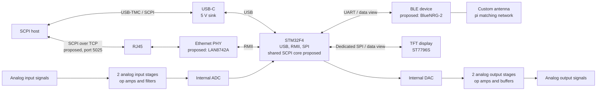
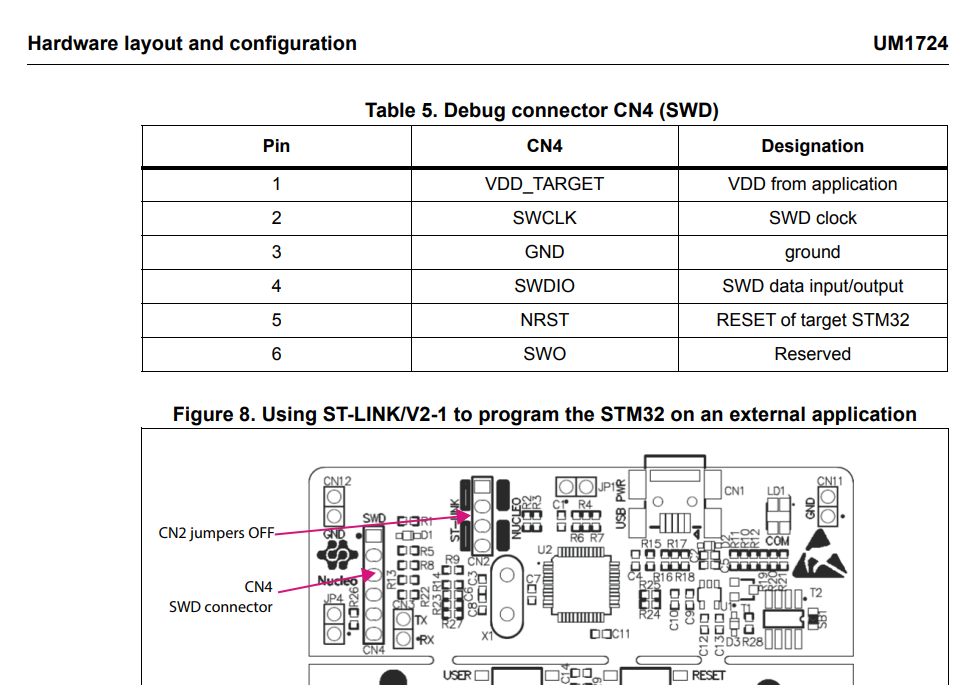

# remoteLAB

A single-board platform based on the STM32F4 family for evaluating Ethernet, USB, Bluetooth Low Energy with a custom antenna, operational-amplifier and buffer stages, and an SPI TFT display. The board is also intended to serve as a SCPI-controlled measurement node in a home laboratory.

## Overview

| Area | Specification |
|---|---|
| MCU | STM32F4 family (F407VGTx); exact device and package to be confirmed after pin budget analysis in CubeMX |
| Power | USB-C, 5 V only (sink); no external supply input |
| Analog | 2 input and 2 output channels built around operational amplifiers, using the MCU's internal ADC and DAC; ranges and component selection to be defined by the designer |
| USB | USB-TMC (SCPI); proposed: CDC console and DFU |
| Ethernet | RMII with external PHY (proposed: LAN8742A), magnetics, RJ45; proposed: SCPI over TCP (port 5025) and UDP sample streaming |
| BLE | Custom PCB antenna with pi-matching network and a VNA measurement pad; proposed: BlueNRG-2 over SPI |
| Display | TFT, 3.5", 320 × 480, ST7796S controller, no touch panel (Powertip PH320480T009-LAA01), driven over SPI |
| Firmware | Proposed: a common SCPI command core shared by USB and Ethernet; BLE and the display act as additional views of the same data |

## Architecture

## Display

| Parameter | Value |
|---|---|
| Panel | Powertip PH320480T009-LAA01 |
| Type / size | TFT, 3.5", 320 × 480 pixels |
| Controller | ST7796S |
| Interface used | SPI (dedicated SPI bus, separate from the BLE device) |
| Supply | VDD 2.5–3.3 V (typ. 2.8 V); VDDI 1.65–3.3 V, must not exceed VDD; 3.3 V logic from the MCU is compatible |
| Connector | 45-pin FPC; type and pitch not specified in the panel datasheet |
| Backlight | White LED, 120 mA typical (150 mA maximum), VF 3.2 V typical; separate LED driver with PWM dimming |

The panel also exposes 8-/9-/16-/18-bit 8080 and 16-/18-bit RGB interfaces. These are not used in this design. The interface is selected with the mode pins IM0–IM2, which should be brought out as jumpers or solder pads. The required logic levels for SPI must be taken from the ST7796S datasheet, as the panel datasheet does not specify them.

A full-frame update is 320 × 480 × 16 bit ≈ 2.46 Mbit. At an SPI clock of 40 MHz this takes about 60 ms (roughly 16 frames per second), so partial updates are recommended. The maximum SPI clock supported by the controller and the MCU is to be verified.

## Design Decisions

- The STM32F4 family does not provide an LTDC peripheral. RGB displays and LVDS display links are therefore excluded, and LVDS has been removed from the scope.
- The display interface is SPI. The FMC peripheral is not used.
- A previously considered BTL power amplifier for a function generator has been cancelled.

## Pin Budget (estimate)

Approximately 35–40 GPIO: RMII (9–10), SPI to the BLE device (about 6), SPI to the display including DC, reset, TE and backlight PWM (about 7), USB (2, plus CC resistors), ADC/DAC (4–6), SWD and boot (about 5). To be verified in CubeMX with respect to alternate-function conflicts.

## Power Considerations (USB-C, 5 V)

- A current budget covering the MCU, PHY, BLE device, display and operational amplifiers must be calculated from datasheet values before components are selected.
- The display backlight is the largest single load: about 120 mA typical at the LED voltage, which corresponds to roughly 0.6 W from the 5 V input including driver losses. This is significant with respect to the 500 mA default limit of a computer USB port.
- As a USB-C sink, the board requires 5.1 kΩ pull-down resistors on the CC lines. Current draw should be designed with margin, and an input current limiter should be considered.
- Symmetric analog supply rails would require a converter from 5 V, which affects noise performance and should be taken into account when defining signal ranges.

## Version 1 Scope

**Required:** Ethernet, USB-C with USB-TMC, BLE with a custom antenna, operational-amplifier sections (2 inputs, 2 outputs), SPI TFT display.
**Desirable:** Test points and jumpers allowing individual analog stages to be bypassed; a common SCPI core.
**Future (optional):** External power input, symmetric supply rails, USB isolation, external ADC.

## Open Items

1. FPC connector type and pitch for the display panel.
2. IM0–IM2 logic levels for SPI mode (ST7796S datasheet) and the backlight LED arrangement (six cathode pins).
3. MCU variant and package, following the CubeMX pin budget.
4. Analog ranges and component selection (operational amplifiers, filters, any converters).
5. Confirmation of the PHY and BLE devices.
6. USB-C current budget, including the display backlight.
7. BLE antenna variants for comparison with a VNA.
